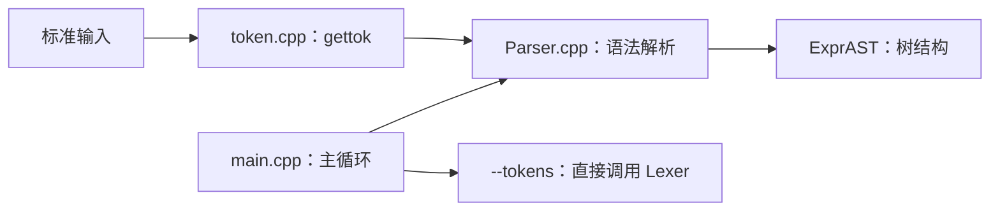

# Kaleidoscope 编译前端架构

核对日期：2026-11-07。实现基线：`ff1210d`。本页描述当前主构建，历史过程见[开发复盘](development-log/2026-11-07-frontend-review.md)。

## 能力与边界

当前程序从标准输入读取源码，完成词法分析与语法解析，构建数字、变量、二元运算、函数调用、函数原型和函数定义的 AST。支持括号、运算符优先级、同级运算左结合及顶层错误恢复。

主构建尚未接入 LLVM IR 生成，不计算表达式，也不检查变量定义、函数存在性和调用参数个数。`main.cpp` 在解析成功后打印提示，随后释放该次解析所得 AST，没有建立持久的函数表。

## 模块关系



| 文件 | 职责与接口 |
| --- | --- |
| [token.h](../token.h)、[token.cpp](../token.cpp) | 声明 token 枚举和 `gettok()`；保存 `IdentifierStr`、`NumVal`；跳过空白和注释 |
| [ExprAST.h](../ExprAST.h)、[ExprAST.cpp](../ExprAST.cpp) | 定义 AST 类型、构造函数及结构读取接口，不依赖 Lexer 或 Parser |
| [Parser.h](../Parser.h)、[Parser.cpp](../Parser.cpp) | 暴露 `getNextToken()`、`CurTok` 和四个顶层解析接口；辅助函数位于实现文件的匿名命名空间 |
| [main.cpp](../main.cpp) | 生产程序入口、顶层分派、交互提示、错误恢复、退出状态和 `--tokens` 模式 |
| [Makefile](../Makefile) | 分别编译源文件并链接为 `build/kaleidoscope`；用 `-MMD -MP` 跟踪头文件依赖 |
| [tests/](../tests/) | 独立测试入口，验证 AST 结构及命令行行为 |

## Lexer 与 Parser 的状态契约

- `gettok()` 返回一个 token；返回 `tok_identifier` 时更新 `IdentifierStr`，返回 `tok_number` 时更新 `NumVal`。其他 token 不保证这些变量包含本次输入的数据。
- `getNextToken()` 调用 `gettok()`，并将结果保存到 `CurTok`。Parser 内推进输入使用此函数。
- 解析前必须调用一次 `getNextToken()`；`CurTok` 始终表示当前尚未消费的 token。
- 解析成功后返回 AST，停在该语法结构之后的第一个 token。例如解析 `1 + 2;` 后，`CurTok` 是 `';'`。
- 解析失败时输出诊断并返回 `nullptr`；主循环决定如何恢复。具体决策见 [ADR-0002](decisions/0002-parser-contract-and-precedence.md)。

Lexer 的 `LastChar` 是函数内静态变量。结合全局的词法结果和 `CurTok`，当前接口适用于单个标准输入流，没有提供多实例解析、状态重置或并发使用接口。

## AST 的职责和所有权

| 类型 | 保存的数据 |
| --- | --- |
| `NumberExprAST` | 数值 |
| `VariableExprAST` | 被引用变量的名字 |
| `BinaryExprAST` | 运算符及左右表达式子树 |
| `CallExprAST` | 被调用函数名及实参表达式列表 |
| `PrototypeAST` | 函数名及形参名列表 |
| `FunctionAST` | 一个 `PrototypeAST` 和一个作为函数体的 `ExprAST` |

前四种是表达式，继承 `ExprAST`。原型和定义通过组合组织函数信息，不继承表达式基类。一个类代表一种节点类型，不意味着它必须独立构成一整棵树。

节点通过 `unique_ptr` 拥有子节点，构造时转移所有权；`ExprAST` 的虚析构函数保证通过基类指针销毁派生对象。模块划分与所有权的设计理由见 [ADR-0001](decisions/0001-frontend-modules-and-ownership.md)。

## 语法与顶层处理

```text
def add(x y) x + y;  # 定义形参使用空白分隔
extern sin(x);
add(12, sin(3.5));   # 调用实参使用逗号分隔
(1 + 2) * 3 < 10;
```

`ParseExpression()` 解析普通表达式；`ParseDefinition()`、`ParseExtern()` 分别解析定义和声明。`ParseTopLevelExpr()` 将独立表达式包装为名为 `__anon_expr` 的无参 `FunctionAST`，此时并不会执行函数。

运算符优先级从低到高为 `<`、`+` / `-`、`*`，同级左结合。括号通过递归解析改变子树结构。

`MainLoop()` 分派 `def`、`extern` 和独立表达式。顶层分号仅作分隔，不产生 AST。出错后 `RecoverFromError()` 跳到分号、下一条 `def` / `extern` 或 EOF；主循环消费分号并继续。只要出现过语法错误，最终退出码为 `1`，正常解析为 `0`。

## 主构建之外

工作区的 `toy.cpp` 含有 LLVM `codegen()` 实现，但未列入 Makefile 的 `SOURCES`。本次未验证它的编译或运行，其角色及后续集成方式仍待确认，不能作为主程序已支持 LLVM 的证据。
